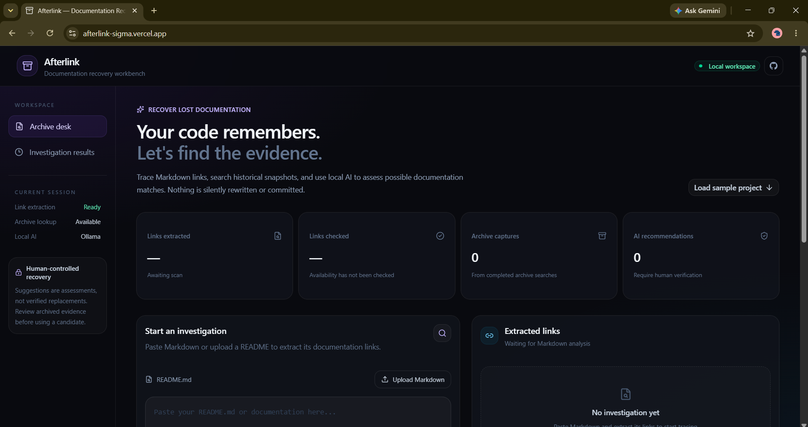
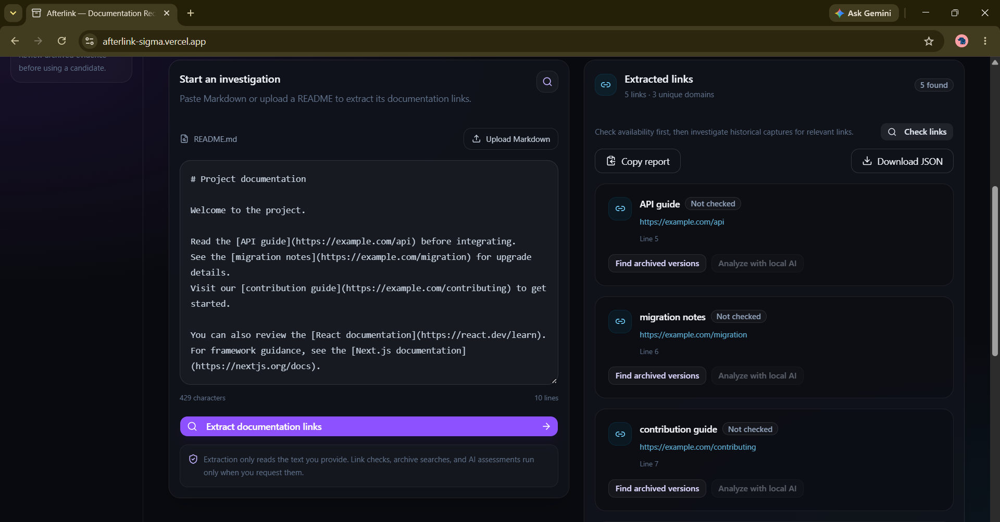
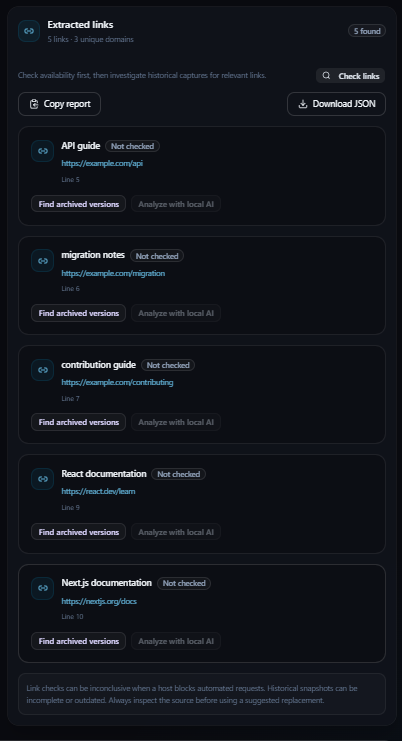
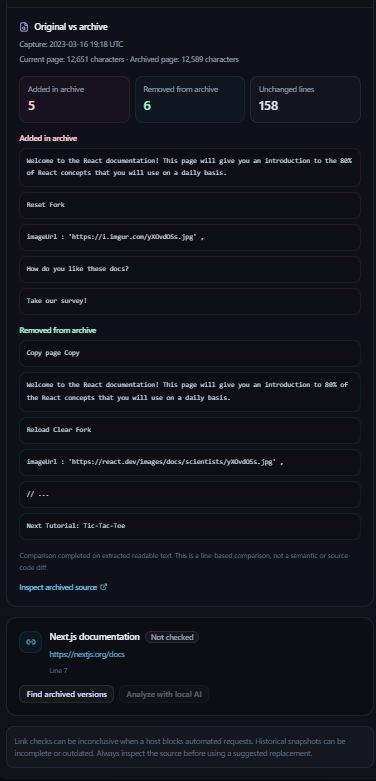
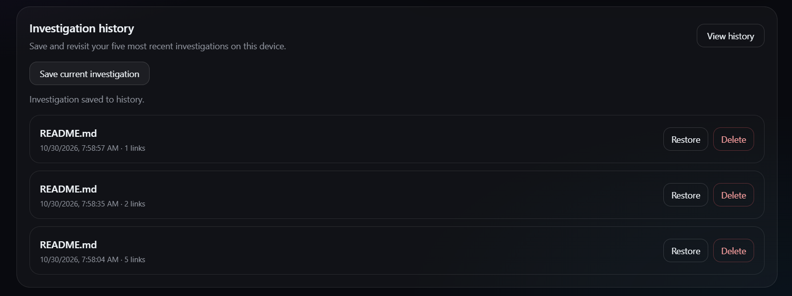

# Afterlink — Investigate the Ghost in the Machine

**Find what disappeared. Recover what remains. Understand what changed.**

Afterlink is a documentation investigation tool that helps developers investigate broken, missing, or changed documentation links using the Internet Archive and AI.

Instead of simply reporting that a link is broken, Afterlink searches for historical snapshots, extracts archived content, compares original and archived material, and produces evidence-backed investigation recommendations.

**Live Demo:** https://afterlink-sigma.vercel.app/

**GitHub Repository:** https://github.com/shrutikotgire0129/afterlink

---

## The Problem

Documentation links disappear, pages move, and important technical information gets lost.

A broken link checker can tell you that a page is unavailable today. It cannot necessarily tell you:

- What the page contained before it disappeared.
- Whether an archived version still exists.
- What changed between the original and archived content.
- Which historical snapshot is relevant to the investigation.

Afterlink helps investigate those questions.

## Screenshots

### 1. Main Interface



### 2. Investigation Workflow



### 3. Investigation Results and AI Evidence



### 4. Original-versus-Archive Content Comparison



### 5. Investigation History



---

## Features

### 1. Markdown Document Analysis
- Upload Markdown or text documentation.
- Extract documentation links for investigation.
- Review discovered links and their status.

### 2. Link Status Checking
- Check whether extracted links are accessible.
- Identify common HTTP failures, redirects, and unavailable pages.
- Distinguish verified results from unverified checks.

### 3. Historical Archive Retrieval
- Search the Internet Archive for historical captures.
- Retrieve available archived versions.
- Display capture information for further investigation.

### 4. Archived Content Extraction
- Extract readable text from archived HTML or plain-text pages.
- Remove common non-content elements and Wayback toolbar content.
- Apply response-size and text-length limits.
- Handle unavailable, oversized, redirected, and unreadable archived pages.

### 5. AI-Powered Investigation
- Run local AI analysis using Ollama and the `gemma3:1b` model.
- Use hosted AI analysis through Groq in the deployed Vercel application.
- Generate investigation recommendations grounded in supplied archive evidence.
- Validate recommendation URLs and evidence excerpts before displaying results.

Afterlink does not treat AI-generated conclusions as independently verified facts.

### 6. Original-versus-Archive Comparison
- Compare available original and archived content.
- Highlight similarities and differences.
- Help identify whether historical content is relevant to the original documentation link.

### 7. Investigation History
- Save multiple investigation snapshots.
- Restore previously saved investigations.
- Delete individual history entries.
- Keep up to five saved investigations in browser storage.

### 8. Investigation Report Export
- Copy an investigation report in Markdown format.
- Download investigation data as JSON.
- Preserve useful findings for later review or sharing.

### 9. Failure Handling
- Validate incoming requests and URLs.
- Handle archive retrieval failures and timeouts.
- Handle unavailable AI services and incomplete model responses.
- Display meaningful error feedback instead of silently accepting invalid results.

---

## Technology Stack

| Technology | Purpose |
|---|---|
| Next.js 16 | Application framework and API routes |
| React | User interface |
| TypeScript | Type safety |
| Tailwind CSS | Styling |
| Ollama | Local AI runtime |
| Gemma 3 1B | Local language model |
| Groq API | Hosted AI analysis on Vercel |
| Internet Archive | Historical documentation captures |
| Browser localStorage | Investigation history |

## Architecture

```text
Markdown / Text Document
          |
          v
   Link Extraction
          |
          v
    Link Checking
          |
          v
 Internet Archive Lookup
          |
          v
  Archived Content Retrieval
          |
          v
       AI Investigation
       /             \
      v               v
 Local Ollama       Hosted Groq
      \               /
       v             v
   Evidence Validation
          |
          v
 Original vs Archive Comparison
          |
          v
  Recommendations & Evidence
          |
          v
   History / Markdown / JSON
```

The application uses Next.js API routes for link checking, archive retrieval, archived-content extraction, and AI analysis.

AI provider selection:
- **Local development:** Ollama with `gemma3:1b`.
- **Vercel deployment:** Groq API with `openai/gpt-oss-20b`.

## Getting Started

### Prerequisites

- Node.js and npm
- Git
- Ollama (for local AI analysis)
- Internet access for retrieving historical captures from the Internet Archive

### 1. Clone the repository

```bash
git clone https://github.com/shrutikotgire0129/afterlink.git
cd afterlink
```

### 2. Install dependencies

```bash
npm install
```

### 3. Configure local AI

Install Ollama from:

https://ollama.com/

Pull the model:

```bash
ollama pull gemma3:1b
```

Verify that it works:

```bash
ollama run gemma3:1b "Reply with READY"
```

Ensure Ollama is running and accessible at:

```text
http://localhost:11434
```

The local AI configuration uses:

```text
Model: gemma3:1b
Ollama API: http://localhost:11434/api/chat
```

### 4. Start the application

```bash
npm run dev
```

Open:

```text
http://localhost:3000
```

### 5. Create a production build

```bash
npm run build
```

Run the production server with:

```bash
npm run start
```

## Deployment

Afterlink is deployed on Vercel:

https://afterlink-sigma.vercel.app/

The deployed application uses Groq for hosted AI analysis.

To configure the hosted AI provider in your own Vercel deployment:

1. Create a Groq API key through the Groq developer platform.
2. Open your Vercel project's **Settings → Environment Variables**.
3. Add the following variable:

```text
GROQ_API_KEY=your_groq_api_key
```

4. Enable it for the required deployment environments.
5. Redeploy the application.

**Security:** Never commit API keys to GitHub or expose them in client-side code.

Local development uses Ollama; the deployed Vercel application uses Groq.

## Important Limitations

Afterlink is an investigation aid, not an authoritative source of historical truth.

- Historical captures depend on Internet Archive availability.
- Some pages may have no archived snapshots.
- Archived content may be incomplete, unavailable, or difficult to extract.
- Dynamic websites and JavaScript-rendered content may not yield complete readable text.
- Content extraction is bounded by a 1 MB response limit and a 12,000-character text limit.
- AI recommendations depend on the quality and availability of the supplied evidence.
- Local AI analysis can take longer depending on hardware and investigation size.
- Browser history is limited to five entries and is stored locally.

An unavailable archived page does not prove that the original page never existed.

## Privacy and Data Handling

- Local AI analysis uses the locally running Ollama service.
- Deployed AI analysis uses the configured Groq API.
- Historical archive lookups and archived-page retrieval require communication with the Internet Archive.
- Investigation history is stored in the browser's localStorage.
- Clearing browser data can remove locally stored investigation history.
- Do not treat browser history as a secure backup.

## Project Motivation

Afterlink was built for the DEV challenge **Ghost in the Machine**.

The project explores a practical question:

**When a documentation page disappears, can we recover enough historical evidence to understand what was lost?**

Rather than treating broken links as simple errors, Afterlink approaches them as investigation starting points.